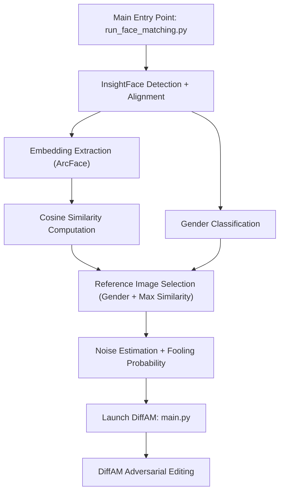

# DiffAM-Driven Adversarial Makeup Transfer and Face Recognition Robustness

## Project Overview

This project presents a GPU-accelerated system for adversarial makeup transfer and face matching, designed to explore and challenge the robustness of modern face recognition systems. Built on top of [DiffAM](https://github.com/HansSunY/DiffAM), this work introduces a pipeline that automatically selects the most similar reference face based on gender and facial features, then applies adversarial makeup to test and potentially fool recognition models.

### Key Features

- Multi-face detection and similarity scoring using ArcFace embeddings (InsightFace)
- Automatic reference image selection by gender and facial similarity
- Diffusion-based adversarial makeup editing with CLIP and face recognition guidance
- Noise budget estimation and fooling rate prediction using a custom mapping model

---

## Datasets

**Similarity Matching:**
- Reference images are organized by gender:
    - `girls/`: Female faces
    - `boys/`: Male faces
- Datasets are curated and processed using InsightFace for alignment, gender classification, and embedding extraction.

**DiffAM Fine-Tuning:**
- Makeup editing leverages pretrained or fine-tuned DiffAM checkpoints, trained on:
    - CelebA-HQ
    - Makeup Transfer Dataset
- Data loaders and alignment scripts are included in the provided Jupyter notebook.

---

## Pipeline Architecture

---

## How It Works

1. **Face Detection & Embedding:** The system detects faces and extracts embeddings using ArcFace.
2. **Gender & Similarity Matching:** Each face is classified by gender, and the most similar reference image is selected from the corresponding dataset.
3. **Adversarial Makeup Transfer:** Using DiffAM, adversarial makeup is applied to the selected image, guided by CLIP and face recognition models.
4. **Noise & Fooling Estimation:** The system estimates the minimum noise required to fool recognition and predicts the likelihood of success.

---

## Usage

1. Prepare your reference datasets in `girls/` and `boys/` folders.
2. Run the main pipeline using the provided scripts or Jupyter notebook.
3. Review the results and fooling rates to analyze face recognition robustness.

---

## Why This Project?

This project demonstrates advanced adversarial techniques in computer vision, combining deep learning, face analysis, and generative models. It is ideal for showcasing expertise in:
- Machine learning and adversarial attacks
- Computer vision and face recognition
- Deep generative models (diffusion, CLIP)
- End-to-end pipeline development

---

## License & Credits

This project builds on [DiffAM](https://github.com/HansSunY/DiffAM) and uses open-source datasets and models. Please see the original repositories for license details.
