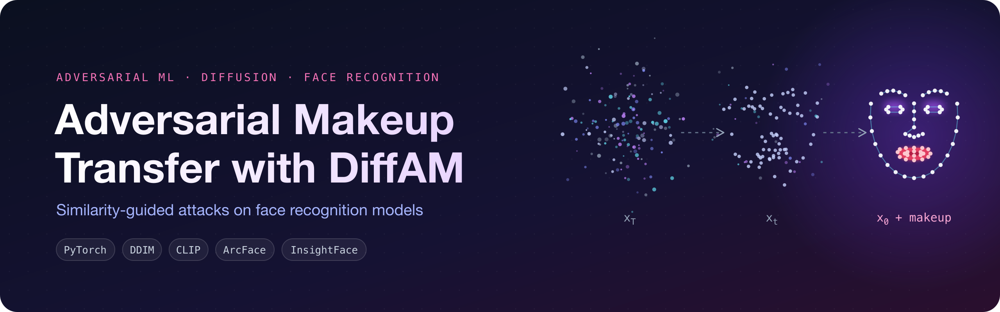
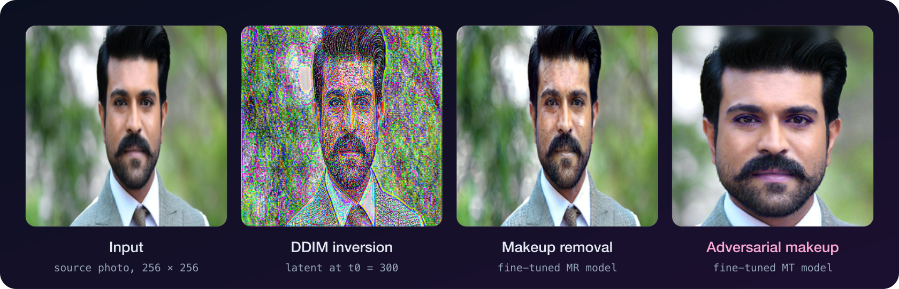
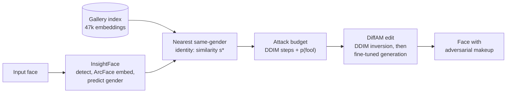

<p align="center">
  
</p>

<p align="center">
  <a href="https://colab.research.google.com/github/Lazypilottt/DiffAM-Driven-Adversarial-Makeup-Transfer-and-Face-Recognition-Robustness/blob/main/notebooks/diffam_colab_experiments.ipynb"></a>
  <a href="https://github.com/Lazypilottt/DiffAM-Driven-Adversarial-Makeup-Transfer-and-Face-Recognition-Robustness/actions/workflows/tests.yml"></a>
  
  
  <a href="LICENSE"></a>
</p>

Face recognition (FR) models can be fooled by makeup. This project reproduces
[DiffAM](https://arxiv.org/abs/2405.09882) (CVPR 2024), a diffusion model that adds natural-looking adversarial
makeup to a face photo, and extends it with a **similarity-guided attack budget**: every face is matched against a
47k-face ArcFace gallery, and how close its nearest look-alike is decides how hard DiffAM pushes.

## Highlights

- **Reproduced both DiffAM stages on a single Colab T4.** Makeup-removal fine-tuning on the MT dataset (30 min)
  and adversarial makeup transfer on CelebA-HQ for three makeup styles (about 4 min each).
- **Built a gender-split ArcFace index over 47,009 reference faces** with InsightFace `buffalo_l`. Embeddings are
  cached once, so a query is one matrix-vector product instead of 47k detector passes.
- **Mapped nearest-identity similarity to an attack budget.** The score sets the number of DiffAM generative steps
  and a predicted fooling probability. A small CLI drives DiffAM's single-image editor without modifying the
  upstream code.
- **Traced two upstream pitfalls.** `--model_ratio` has no effect, and runs shorter than three iterations never
  switch on the adversarial loss. Details in [docs/method.md](docs/method.md#3-notes-on-the-upstream-code).
- **Tested.** 34 unit tests and CI for the budget, index and launcher. They run without a GPU or model downloads.

## Results

<p align="center">
  
</p>

Single-image edits on a Colab T4: makeup removal takes about 17 s (t0 = 300, 40 DDIM steps) and adversarial
makeup transfer about 19 s (t0 = 60, 6 steps). Raw outputs are in [`results/`](results).

**Makeup removal fine-tuning** (MT dataset, 50 train / 10 test images, 4 iterations, t0 = 150). The mean CLIP
direction loss fell from 0.55 to 0.38 across the four iterations, while the mean identity loss stayed below
0.035, so makeup was removed without changing who the person is.

**Adversarial makeup transfer** (CelebA-HQ, target identity 1, black-box model MobileFace with FaceNet, IR152 and
IRSE50 as surrogates; 50 train / 10 test images, `n_iter 2`, t0 = 30):

| Makeup style | ASR @ FAR 0.1 | ASR @ FAR 0.01 | ASR @ FAR 0.001 | Fine-tuning time |
|:--|:--:|:--:|:--:|:--:|
| XMY-254 | 70% | 20% | 0% | 224 s |
| XYH-045 | 70% | 20% | 0% | 224 s |
| vRX912  | 70% | 20% | 0% | 222 s |

> [!NOTE]
> Treat these numbers as a **baseline without the attack term**. DiffAM keeps the adversarial loss out of the
> objective for the first `MT_iter_without_adv = 3` iterations, and these runs stopped after 2. That is also why
> all three styles score the same. Re-running with `--n_iter 4` is the next experiment
> ([limitations](docs/method.md#4-limitations-and-next-steps)).

**Reference gallery:** 47,009 faces (23,766 male / 23,243 female) embedded in about 11.5 min (~68 images/s).

## How it works



1. **Match.** The input's largest face is embedded with ArcFace, and its gender is predicted. The cached gallery
   is searched for the most similar face of the same gender, using cosine similarity *s\**.
2. **Budget.** The hypothesis is that a face already close to another identity needs a smaller push to be
   misidentified. The step budget falls linearly from 40 to 5 as *s\** rises, and the predicted fooling
   probability is a logistic curve centred at *s\** = 0.6.
3. **Edit.** DiffAM inverts the input with deterministic DDIM to t0, then regenerates it with the adversarially
   fine-tuned model for the chosen number of steps.

| s\* | tier | DDIM steps | p(fool) |
|:--:|:--:|:--:|:--:|
| 0.95 | high | 7 | 97% |
| 0.75 | medium | 14 | 82% |
| 0.60 | low | 19 | 50% |
| 0.30 | low | 30 | 5% |

The budget curves are hand-set and still need to be fitted against measured ASR. The full formulation, DiffAM's
loss terms and the upstream notes are in [docs/method.md](docs/method.md).

## Repository layout

```
makeup_attack/            similarity-guided attack: gallery index, budget, DiffAM launcher, CLI
tests/                    unit tests (no GPU, no model downloads)
notebooks/                Colab notebook with every training and evaluation run
docs/method.md            DiffAM background, budget formulation, upstream notes, limitations
results/                  raw outputs of the single-image edits
assets/                   README figures
scripts/setup_diffam.sh   fetches upstream DiffAM at the pinned commit
```

## Getting started

**1. Install**

```bash
git clone https://github.com/Lazypilottt/DiffAM-Driven-Adversarial-Makeup-Transfer-and-Face-Recognition-Robustness.git
cd DiffAM-Driven-Adversarial-Makeup-Transfer-and-Face-Recognition-Robustness
pip install -e ".[face]"        # swap onnxruntime for onnxruntime-gpu on CUDA machines
```

**2. Set up DiffAM**

```bash
scripts/setup_diffam.sh         # clones HansSunY/DiffAM into third_party/DiffAM at 323aef8
```

Then download the pretrained weights, `assets.zip` and CelebAMask-HQ as described in the
[DiffAM README](https://github.com/HansSunY/DiffAM#pretrained-models-and-datasets), and fine-tune a makeup style
(or reuse a checkpoint from the notebook).

**3. Build the gallery index**

```bash
python -m makeup_attack index --gallery reference_pool --out cache/gallery.npz
```

`reference_pool/` holds `male/` and `female/` subfolders (`boys/` and `girls/` also work).

**4. Match and attack**

```bash
python -m makeup_attack match --image face.jpg --top-k 5
python -m makeup_attack run --image face.jpg --mode MT \
    --checkpoint third_party/DiffAM/checkpoint/<style>.pth
python -m makeup_attack estimate 0.9 0.7 0.5     # budget table, no models needed
```

Add `--dry-run` to `run` to print the DiffAM command without launching it.

**Tests**

```bash
pip install -e ".[dev]"
pytest && ruff check .
```

**Colab.** The [notebook](notebooks/diffam_colab_experiments.ipynb) contains the full pipeline: environment setup,
reference pool, makeup removal, makeup transfer, single-image edits and the similarity-guided CLI.

## Responsible use

Adversarial makeup is dual-use. DiffAM was designed to protect people's photos from unauthorised face
recognition, and this project studies how robust FR models are to that kind of edit. Use it on your own images or
with consent, and only for research.

## Acknowledgements

- [DiffAM](https://github.com/HansSunY/DiffAM) by Sun et al. is the diffusion backbone. Its code is fetched by the
  setup script and not redistributed here.
- [InsightFace](https://github.com/deepinsight/insightface) for detection, ArcFace embeddings and gender prediction.
- [OpenAI CLIP](https://github.com/openai/CLIP), [CelebAMask-HQ](https://github.com/switchablenorms/CelebAMask-HQ),
  the MT makeup dataset, and the
  [Gender Classification Dataset](https://www.kaggle.com/datasets/cashutosh/gender-classification-dataset).

```bibtex
@InProceedings{Sun_2024_CVPR,
    author    = {Sun, Yuhao and Yu, Lingyun and Xie, Hongtao and Li, Jiaming and Zhang, Yongdong},
    title     = {DiffAM: Diffusion-based Adversarial Makeup Transfer for Facial Privacy Protection},
    booktitle = {Proceedings of the IEEE/CVF Conference on Computer Vision and Pattern Recognition (CVPR)},
    year      = {2024},
    pages     = {24584-24594}
}
```

## License

Code in this repository is released under the [MIT License](LICENSE). DiffAM, the pretrained weights and the
datasets keep their own licenses and terms.

---

<p align="center">Aditya Yadav · IIT Bhilai</p>
